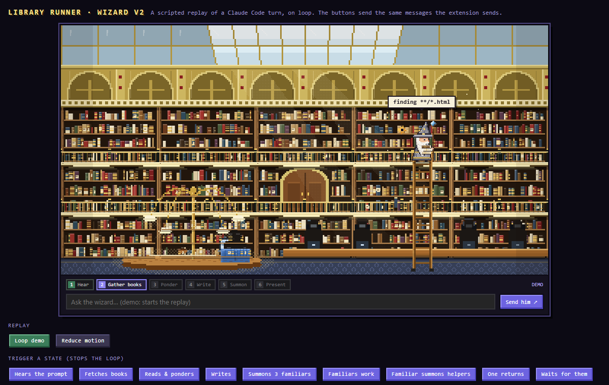

# Library Runner

A pixel-art wizard for VS Code. Every time you ask an AI something, he takes your note, runs to a grand domed reading room, climbs the ladders, tinkers with the books and runs back with the answer.



It works with GitHub Copilot Chat (or any extension that provides language models to VS Code) and with Claude Code. You can try it with no AI connected at all: run **Library Runner: Play Demo**. There is also a standalone browser version of the demo in `docs/demo.html`.

## What he does

| On screen | What is really happening |
| --- | --- |
| Takes a note and runs to the library | Your prompt was sent |
| Pulls books, gear spinning over his head | The model is working. The bubble names the file or search |
| Climbs the ladder to the upper galleries | The search is getting deeper (longer thinking, more tool calls) |
| Summons familiars, who can summon helpers | Parallel work: subagents and background tasks |
| Runs back with a book, then returns | A long task with many steps. Each delivered book is one batch |
| Trips and sees stars | A tool call or request failed. He shrugs and retries |
| Stops with a red card | He needs your permission |
| Staff glows gold | He has the answer |
| Hops and hands you a scroll | The answer card, with Copy / Insert / Replace buttons |
| Dozes off (zzz) | Nothing has happened for a while |

## Install

You need VS Code 1.90 or later.

### Option 1: build the .vsix and install it

Windows, no Node needed:

```
powershell -ExecutionPolicy Bypass -File build-vsix.ps1
code --install-extension library-runner-0.2.0.vsix
```

Any platform, with Node:

```
npx @vscode/vsce package
code --install-extension library-runner-0.2.0.vsix
```

You can also use the Extensions view, the `...` menu, then **Install from VSIX...**.

### Option 2: run it from source

Open this folder in VS Code and press **F5**. A second VS Code window opens with the extension loaded.

## Three ways to use it

1. **The panel prompt box.** Open the **Library Runner** panel (next to Terminal) and type a question. If you have code selected, it is sent as context. Ask something starting with *fix*, *refactor*, *rewrite* and he asks before replacing your selection.
2. **`@wizard` in the Chat view.** Type `@wizard how does this work?` in Copilot Chat. The answer streams into chat while he works in the panel.
3. **Claude Code.** Run **Library Runner: Connect Claude Code** once. He then follows every Claude Code session: each file read, search, edit and command shows up as a trip to the shelves.

Options 1 and 2 use VS Code's Language Model API, so they need GitHub Copilot Chat (or another extension that provides models) installed and signed in. Option 3 needs only Claude Code.

## Commands

- **Library Runner: Ask the Wizard**
- **Library Runner: Play Demo**
- **Library Runner: Change Skin** (Wizard, Librarian, Robot or Cat)
- **Library Runner: Call the Wizard Back (Cancel)**
- **Library Runner: Connect Claude Code** / **Disconnect Claude Code**

Click the **Wizard** item in the status bar to open the panel.

## Configuration

Library Runner has no API keys and reads no environment variables. Everything is a normal VS Code setting (File, Preferences, Settings, search "Library Runner"):

| Setting | Default | |
| --- | --- | --- |
| `libraryRunner.skin` | `wiz` | `wiz`, `lib`, `bot` or `cat` |
| `libraryRunner.reduceMotion` | `false` | Turns off flying books, dust and bobbing |
| `libraryRunner.revealOnPrompt` | `true` | Shows the panel when a prompt starts, without stealing focus |
| `libraryRunner.claudeCode.enabled` | `true` | Follow Claude Code activity |
| `libraryRunner.modelFamily` | *(empty)* | Model for the panel box, for example `gpt-4o`. Empty means the first Copilot model |

## How the Claude Code connection works

The connect command adds six hooks (`UserPromptSubmit`, `PreToolUse`, `PostToolUse`, `Notification`, `Stop`, `SubagentStop`) to `~/.claude/settings.json`, after saving a backup to `settings.json.library-runner.bak`. Each hook runs a tiny script in `~/.library-runner/` (`lr-hook.js` where Node is available, otherwise the PowerShell or shell version) that appends the event to `~/.library-runner/events.jsonl`. The extension watches that file. Nothing leaves your machine.

**Privacy note.** `events.jsonl` is a raw copy of Claude Code's hook events, so it can contain your prompts, file paths and tool inputs. It lives in your home folder, not in this repository, and `.gitignore` excludes it. Do not commit it or share it. The extension empties it at startup when it grows past 5 MB. **Disconnect Claude Code** removes the hooks again; you can then delete `~/.library-runner/`.

On Windows the PowerShell hook adds a fraction of a second per tool call. The Node hook is about four times faster, so install Node if you use Claude Code heavily.

## Tips

- Drag the panel into the **Secondary Side Bar** for a tall "corner buddy" view. When the view is smaller than the room, the camera follows him around.
- The pixel fonts load from Google Fonts. Offline, it falls back to a monospace font.

## Repository layout

| Path | What |
| --- | --- |
| `extension.js` | The extension: panel, chat participant, Claude Code bridge |
| `media/` | The webview (canvas engine in `main.js`, styles, icons) |
| `hooks/` | The three hook scripts copied to `~/.library-runner/` on connect |
| `tools/build-demo.js` | Rebuilds `docs/demo.html` from `media/` (`node tools/build-demo.js`) |
| `build-vsix.ps1` | Packages the extension without Node or vsce |

## Licence

MIT. See `LICENSE`.
